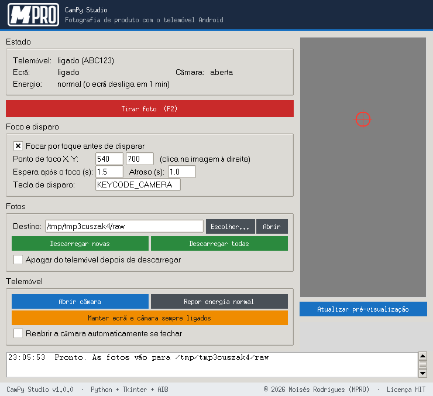

# CamPy Studio

  

Aplicação Windows (Python + Tkinter) para **fotografar produtos com um telemóvel Android fixo**, ligado por USB. O PC dispara a câmara por ADB e descarrega as fotos para a pasta `raw/`, prontas a editar.

Pensada para fotografar figuras impressas em 3D para uma loja online, mas serve para qualquer fotografia de produto com um tripé.



## Funcionalidades

- **Tirar foto** com foco por toque num ponto à escolha (clica na pré-visualização do ecrã do telemóvel). Atalho: `F2`.
- **Nomes por data e hora** (`AAAAMMDD_HHMMSS.jpg`); nunca substitui ficheiros (acrescenta `_1`, `_2`...).
- **Descarregar novas** ou **todas** as fotos do telemóvel, para `raw/` ou para outra pasta; as que já existem no destino são ignoradas.
- **Apagar do telemóvel** depois de descarregar (opcional, desligado por omissão; só apaga após confirmar o tamanho do ficheiro).
- **Reabrir a câmara** se fechar, com reabertura automática opcional.
- **Manter ecrã e câmara sempre ligados** (com o cabo ligado) e **repor** as definições de energia originais.
- Painel de estado do telemóvel, ecrã, câmara e energia.

## Requisitos

- Windows 10/11 (funciona também em Linux/macOS com Tkinter).
- [Python 3.10+](https://www.python.org/downloads/) com Tkinter (incluído no instalador oficial).
- `adb` (Android platform-tools) no `PATH`:
  ```powershell
  winget install Google.PlatformTools
  ```
- Telemóvel Android com **Depuração USB** ativa (Definições > Opções de programador).

Opcional: `pip install Pillow` para um logótipo com melhor qualidade.

## Instalação e utilização

```powershell
git clone https://github.com/Moisesfprodrigues/campy-studio.git
cd campy-studio
python campy_studio.py
```

Para abrir sem janela de consola: `pythonw campy_studio.py`.

1. Liga o telemóvel por USB e aceita a autorização RSA no ecrã (primeira vez).
2. Confirma que o estado mostra **ligado**.
3. Clica em **Atualizar pré-visualização** e depois na imagem, no ponto onde o produto deve ficar focado.
4. Clica em **Tirar foto** (ou `F2`). A foto aparece em `raw/`.

> O botão de disparo usa `KEYCODE_CAMERA`, que funciona no Samsung Galaxy A7 (2018). Noutros modelos, pode ser preciso mudar a tecla no campo **Tecla de disparo** (por exemplo `KEYCODE_VOLUME_DOWN`).

## Ficheiros criados pela aplicação

| Ficheiro | Para quê |
|---|---|
| `raw/` | Pasta de destino por omissão das fotos. |
| `logs_img.txt` | Nomes das fotos do telemóvel já descarregadas (evita repetições). |
| `campy_studio_config.json` | Opções guardadas entre sessões (foco, destino, etc.). |

Quem vem da versão anterior (`camara_app`): `camara_app_config.json` e `camara_app_baixados.txt` são renomeados automaticamente no primeiro arranque.

## Executável (.exe)

```powershell
.\build_exe.ps1
```

Gera `dist\CamPyStudio.exe`. O `adb` continua a ser necessário no `PATH`.

## Testes

```powershell
pip install -r requirements-dev.txt
python -m pytest -q
```

Os testes usam um telemóvel simulado; não precisam de hardware. Em Linux sem ecrã: `xvfb-run -a python -m pytest -q`.

## Segurança e limitações

- A depuração USB dá controlo total do telemóvel ao PC autorizado: autoriza apenas computadores de confiança e desativa a opção quando não a usares.
- Com PIN ou padrão, a aplicação não consegue desbloquear o telemóvel; desbloqueia-o à mão e usa **Manter ecrã e câmara sempre ligados**.
- "Manter ecrã ligado" mantém o ecrã aceso de forma contínua: usa-o ligado ao carregador e repõe depois.

## Estrutura

```
campy_studio.py        aplicação (lógica ADB + interface)
test_campy_studio.py   testes (pytest)
assets/                logótipo (logo.svg original, logo.png claro p/ cabeçalho, logo_preto.png, logo.ico)
raw/                   fotos descarregadas (conteúdo ignorado pelo git)
build_exe.ps1          gera o executável
```

## Licença

[MIT](LICENSE) © 2026 Moisés Rodrigues (MPRO)
